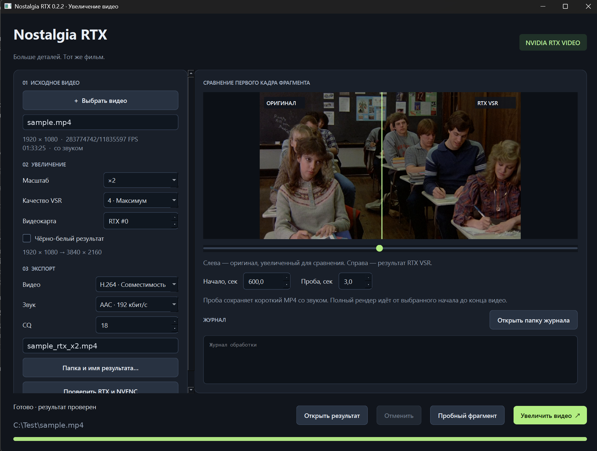

# Nostalgia RTX 0.2.2 — Windows x64

[English](README.md) · **Русский**

Увеличение видео через **NVIDIA RTX Video SDK 1.1 / RTX Video Super Resolution**, с оконным интерфейсом и экспортом MP4 через NVENC.



В архиве уже собраны `NostalgiaRTX.exe` и `bin/nostalgia_rtx.dll`; присутствует официальный release-runtime `nvngx_vsr.dll`. Исходники приложены. Это экспериментальная сборка: исполняемые файлы собраны для Windows, но запуск на Windows и NVIDIA GPU в среде разработки недоступен. Начните с аппаратной проверки и короткой пробы.

## Первый запуск

Если версия 0.2 или 0.2.1 уже установлена, закройте приложение и распакуйте этот архив поверх папки `NostalgiaRTX` с заменой файлов. Папки `.runtime` и `.downloads` сохраняются; повторно запускать `INSTALL.cmd` не нужно. Версия 0.2.2 видна в заголовке окна.

В 0.2.2 проверка результата показывает ожидаемые и фактические размеры, FPS и число кадров. Незначительное округление среднего FPS контейнером допускается только при совпадении числа кадров и длительности; реальная смена частоты или потеря кадров остаётся ошибкой. Если проверка не пройдена, завершённый MP4 сохраняется рядом с результатом с пометкой `_unverified_`, а исходные данные FFprobe — как `input-probe.json` и `output-probe.json` в папке сеанса. Такой MP4 ещё не считается подтверждённым результатом.

1. Полностью распакуйте архив, например в `C:\Apps\NostalgiaRTX`. Не запускайте программу внутри ZIP и не переносите EXE отдельно от папки.
2. Откройте `INSTALL.cmd`. Установка скачает около **185 МБ**: локальный Python, Qt, NumPy, Pillow и FFmpeg. Все загрузки закреплены по версии и SHA256; устанавливаются в папку приложения. Системный Python, Visual Studio, CUDA Toolkit и TensorRT для запуска не требуются. Нужен интернет при первой установке и достаточно места для распаковки, около 2 ГБ.
3. После установки запускайте `NostalgiaRTX.exe`. Для вывода ошибок в консоль используйте `START.cmd`.

Программа не изменяет системный Python и не требует прав администратора. Папка должна быть доступна для записи. После установки зависимостей видео обрабатывается локально; приложение не загружает исходник на сервер.

Требования: Windows 10/11 x64, NVIDIA GeForce RTX и совместимый актуальный драйвер. Пакет SDK 1.1 поддерживает RTX 50. Встроенная проверка определяет доступность VSR и NVENC на конкретном ПК.

## Как обработать видео

1. Нажмите **«Проверить RTX и NVENC»**: выполняются настоящее VSR-преобразование тестового кадра и пробное кодирование.
2. Выберите или перетащите видео в окно. Укажите новое имя MP4.
3. Оставьте **×2, качество 3, H.264, CQ 18, RTX #0** для первой пробы. Цвет сохраняется; чёрно-белый результат включается отдельно.
4. Выберите начало фрагмента в секундах и нажмите **«Пробный фрагмент»**. По умолчанию сохраняются 3 секунды со звуком. Имя содержит `_preview_` и случайный суффикс.
5. Сравните первый кадр ползунком, затем откройте пробный MP4: статичный кадр не показывает мерцание и ошибки на движении.
6. Нажмите **«Увеличить видео»**, чтобы обработать ролик от выбранной отметки до конца.

Для 1920×1080 масштаб ×2 даёт 3840×2160 (4K), а ×4 — 7680×4320 (8K). Для результата со стороной больше 4096 приложение автоматически выбирает H.265; кодек можно изменить вручную. Перед загрузкой VSR кодирование проверяется на одном чёрном кадре **реального выходного разрешения**, с выбранным кодеком и CQ. При отказе кодировщика VSR не запускается, а сообщение объясняет причину. Кнопка проверки RTX/NVENC также использует выходное разрешение выбранного видео. Результат ограничен 8192 пикселями по каждой стороне; возможности NVENC дополнительно зависят от видеокарты и кодека.

Качество VSR: 1 — Low, 2 — Medium, 3 — High, 4 — Ultra. Это реальные уровни SDK; масштабирование без ИИ скрыто не подставляется. Если VSR недоступен, операция завершается с ошибкой.

CQ управляет потерями при сжатии: меньшее число обычно даёт больше размер файла. Для звука доступны AAC 192 кбит/с и копирование исходных дорожек. Если исходный аудиокодек несовместим с MP4, используйте AAC.

## Ограничения первой версии

- Поддерживается progressive SDR с квадратными пикселями. Внутренний путь — 8-битный BGRA/RGBA, экспорт — 8-битный YUV 4:2:0 BT.709. HDR и анаморфное/чересстрочное видео отклоняются. Поддержка 10 бит в самом SDK не означает её наличие в этой версии программы.
- Поворот на 90°, 180° и 270° нормализуется декодером. Для других углов сначала подготовьте исходник.
- FPS сохраняется как дробное число, например `24000/1001`. Переменная частота приводится к постоянной средней частоте; интерполяции кадров нет.
- Переносятся все аудиодорожки; субтитры и главы не переносятся.
- Сравнение показывает первый обработанный кадр выбранного фрагмента. Оригинал для сравнения увеличивается Lanczos до того же отображаемого размера.
- Кадры целиком проходят VSR на GPU. Между FFmpeg и SDK есть копирование через RAM; декодирование и кодирование не образуют полностью GPU-резидентный конвейер.
- Прогресс и оставшееся время приблизительные. Возобновление после прерывания не реализовано.
- При отмене дочерние процессы останавливаются. Если обработчик не отвечает 8 секунд, приложение пытается принудительно завершить его дерево процессов. После такой остановки может остаться папка `.nostalgia-render-*` рядом с результатом; её можно удалить после закрытия приложения.
- Имена готовых файлов не перезаписываются. Готовое имя получает только результат, у которого проверены размеры, FPS, длительность и наличие звука. Исходный файл не изменяется.

Логи и сравнения кадров: `%LOCALAPPDATA%\NostalgiaRTX\sessions`. Нажмите **«Открыть папку журнала»**, чтобы открыть папку текущего сеанса. При ошибке пришлите `session.log` и, если они есть, `input-probe.json` и `output-probe.json`. Если не открывается интерфейс, смотрите `startup.log` рядом с EXE и запустите `START.cmd`.

## Что проверено

- Windows PE x64 EXE/DLL успешно скомпилированы; модуль связан с настоящей библиотекой SDK 1.1.
- Интерфейс запущен и визуально проверен в Linux с Qt offscreen, включая маленький размер окна.
- Автоматические тесты проверяют поток FFmpeg, звук, дробный FPS, порядок цветов, отмену, защиту от перезаписи, геометрию и события интерфейса.
- В тестах конвейера GPU заменён тестовым обработчиком.
- На Windows-ПК автора с видеокартой NVIDIA RTX успешно пройдены установщик PowerShell и рендер с проверкой результата. Другое оборудование, драйверы и длинные фильмы не проверялись.

## Исходники и пересборка

`nostalgia/gui.py` — интерфейс; `pipeline.py` — видео и звук; `backend.py` — вызовы DLL; `native/rtx_bridge.cpp` — Direct3D 11 / NGX VSR; `native/launcher.c` — EXE запуска.

Для пересборки нужен Visual Studio C++ x64 Build Tools и отдельно полученный SDK 1.1. Из **x64 Native Tools Command Prompt**:

```powershell
powershell.exe -NoProfile -ExecutionPolicy Bypass -File scripts\Build-Windows.ps1 -Sdk "D:\SDK\RTX_Video_SDK_v1.1.0"
```

Установка runtime не собирает программу заново. Полный SDK, его заголовки и developer tools в этот архив не включены.

Официальные источники:

- RTX Video: https://developer.nvidia.com/rtx-video-sdk/getting-started
- SDK 1.1: https://catalog.ngc.nvidia.com/orgs/nvidia/multimedia/models/dlpp/1.5/file-browser
- Python: https://www.python.org/downloads/windows/
- Qt for Python: https://doc.qt.io/qtforpython-6/
- FFmpeg build: https://github.com/GyanD/codexffmpeg/releases/tag/7.1.1

## Лицензия

Исходный код проекта, написанный автором, распространяется по [Apache License 2.0](LICENSE) (см. также [NOTICE](NOTICE)). Эта лицензия относится только к оригинальному коду автора. Она **не распространяется** на компоненты NVIDIA (`nvngx_vsr.dll`, объектный код NVIDIA в `nostalgia_rtx.dll` и любые материалы, предоставленные NVIDIA) и на другие сторонние компоненты: у них собственные лицензии. Собранный релизный архив содержит компоненты NVIDIA и регулируется [EULA](EULA.md) (двуязычное; согласие требуется при установке и первом запуске).

Условия компонентов и атрибуция — в `licenses` и [THIRD-PARTY-NOTICES.md](THIRD-PARTY-NOTICES.md). Приложение использует NVIDIA RTX Video SDK 1.1. NVIDIA и RTX — товарные знаки NVIDIA Corporation. Это самостоятельное приложение, не продукт NVIDIA или Topaz и не одобрено ими.

Кадр на скриншоте взят из художественного фильма и нужен только для иллюстрации интерфейса.
